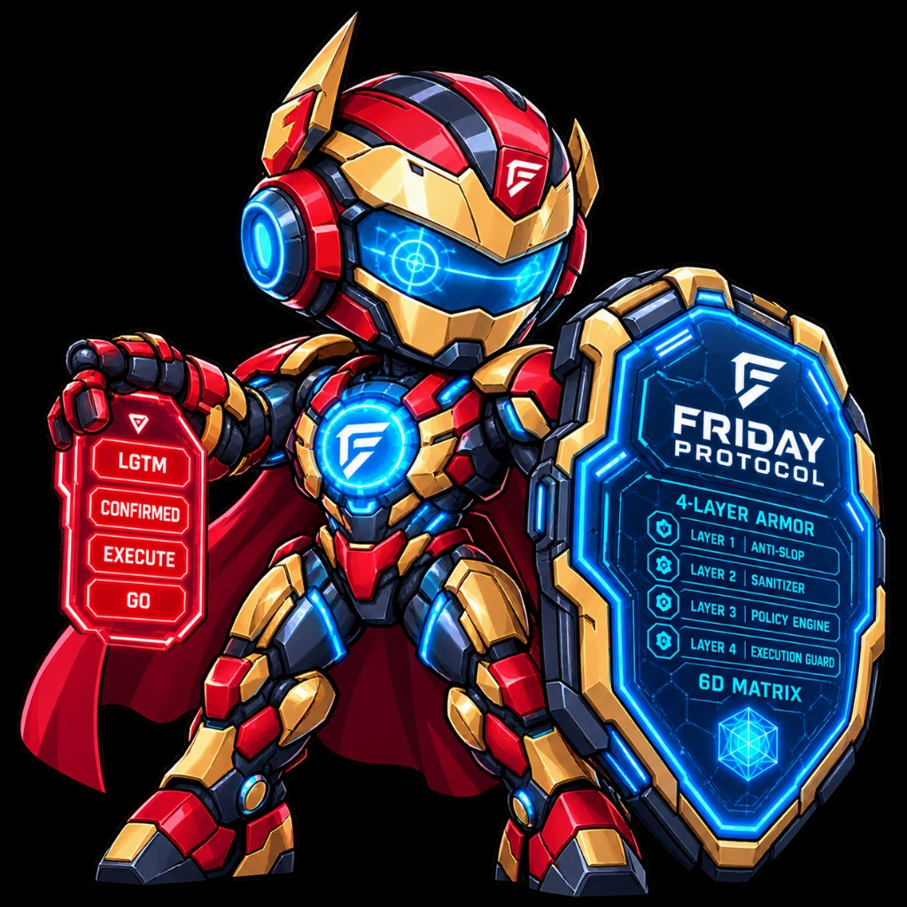
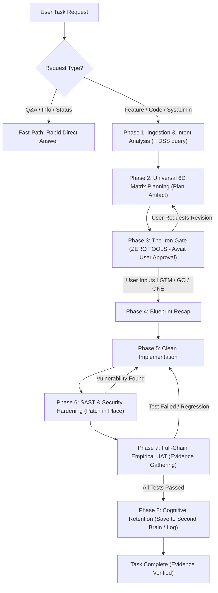

<p align="center">
  
</p>

# 🛡️ FRIDAY-PROTOCOL

> **F**ramework for **R**igorous, **I**ntelligent, **D**eliberate, and **A**utonomous **Y**ields  
> *The Spec-Driven, DevSecOps-First, and Anti-Hallucination Governance Protocol for Autonomous AI Agents.*

<p align="center">
  <a href="https://www.npmjs.com/package/friday-protocol"></a>
  <a href="LICENSE"></a>
  
  
</p>

---

## ⚡ Why FRIDAY-PROTOCOL?

Most AI agents today suffer from three critical flaws:
1. **Eager Execution Bias:** The agent immediately starts generating code before you have even reviewed or approved the architecture plan.
2. **Ping-Pong QA & Tunnel Vision:** Fixing a live preview bug silently breaks downstream consumers (e.g. PDF generation, state persistence, cold reloads).
3. **Broken Access Control & Security Oversights:** The agent relies on client-side styling (`v-if`, `hidden`) while leaving backend endpoints and WebSocket channels completely unguarded.

**FRIDAY-PROTOCOL eliminates these problems by transforming your AI into a disciplined Staff Software Engineer.**

---

## 🏛️ The 5 Iron Laws

1. **Law of Deliberation:** The AI is physically forbidden from touching a single line of code until the Operator explicitly approves the Implementation Plan.
2. **Law of Universal 6D Lifecycle Matrix:** Every feature must map its journey across 6 dimensions (*Source $\rightarrow$ Runtime State $\rightarrow$ Persistence $\rightarrow$ Downstream Consumers $\rightarrow$ RBAC/Security $\rightarrow$ Failure Modes*).
3. **Law of Security-First (Early Gate):** SAST and multi-role access control checks must pass **BEFORE** functional UAT to eliminate regression loops.
4. **Law of Empirical Proof:** The AI may never declare a task "complete" without hard, objective evidence (exit code 0, HTTP 200 OK, terminal logs).
5. **Law of Cognitive Closed-Loop (Optional):** Integrates with external Knowledge Graphs (e.g., MemoriaGraph) to query past decisions before planning and store learned patterns after deployment.

---

## 🔒 4-Layer Anti-Bypass Guard (Always-Proceed Proof)

Even when the user enables `--dangerously-skip-permissions`, YOLO mode, or `Always Proceed`:
- **Zero-Tool Turn Termination:** Once the plan is drafted, the agent executes **zero tools**, forcing the autonomous loop to halt and yielding control back to the operator.
- **Semantic Approval Token:** Code editing tools are programmatically locked until the operator explicitly inputs a manual token: `['LGTM', 'CONFIRMED', 'EXECUTE', 'GO', 'OKE', 'GASS']`.
- **Pre-Tool Hook Gate:** Real-time hook interceptors abort unauthorized write attempts.

---

## 🚀 Quick Start (Zero-Install CLI)

Run directly via `npx` (no cloning or pre-installation needed):

```bash
npx friday-protocol
```

Or pass flags for silent/automated CI environments:
```bash
# Universal global setup
npx friday-protocol -y

# Specific agent & workspace scope
npx friday-protocol --env antigravity --scope workspace -y
```

---

### Alternative: Direct Shell Scripts

<details>
<summary><b>Windows (PowerShell)</b></summary>

```powershell
irm https://raw.githubusercontent.com/lhermawan/friday-protocol/main/install.ps1 | iex
```
</details>

<details>
<summary><b>Linux / macOS (Bash)</b></summary>

```bash
curl -fsSL https://raw.githubusercontent.com/lhermawan/friday-protocol/main/install.sh | bash
```
</details>

The interactive installer will prompt:
1. **Target Agent Environment:** Antigravity (Gemini), Claude Code, Cursor, Windsurf, or Universal (All).
2. **Installation Scope:** Global (machine-wide) or Workspace-specific.
3. **Second Brain / Cognitive Mode:** Enable MCP Knowledge Graph integration (with DSS) or pure Standalone DevSecOps.

---

## 🔄 The 8-Phase Execution Pipeline



---

## 📂 Repository Layout

```text
friday-protocol/
├── README.md                   # You are here
├── LICENSE                     # MIT License
├── install.ps1                 # Windows PowerShell Installer
├── install.sh                  # Linux / macOS Bash Installer
├── core/
│   └── rules/
│       ├── GEMINI.md           # Rule template for Gemini / Antigravity
│       ├── CLAUDE.md           # Rule template for Claude Code
│       ├── .cursorrules        # Rule template for Cursor / Windsurf
│       └── AGENTS.md           # Standard protocol for Multi-Agent systems
├── skills/
│   └── friday-protocol/
│       ├── SKILL.md            # Comprehensive SOP and runbook
│       └── references/
│           ├── 6d-matrix.md    # 6D Lifecycle Matrix reference
│           └── sast-checklist.md # OWASP & BFLA audit checklist
└── templates/
    ├── plan-template.md        # Implementation plan scaffolding
    └── uat-checklist.md        # Evidence verification sheet
```

---

## 🤝 Contributing

Contributions are welcome! Submit a Pull Request or file an issue to enhance the SAST heuristics, add new agent harness integrations, or extend the lifecycle matrix.

## 📄 License

MIT License. Designed by Bos Maskii (Lucky Hermawan) & F.R.I.D.A.Y.
