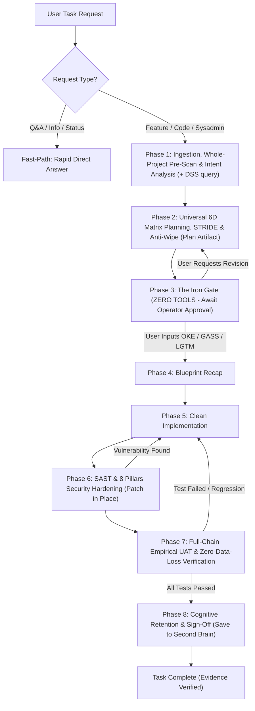

<p align="center">
  
</p>

# 🛡️ FRIDAY-PROTOCOL v2.2

> **F**ramework for **R**igorous, **I**ntelligent, **D**eliberate, and **A**utonomous **Y**ields  
> *The Spec-Driven, DevSecOps-First, and BSSN-Aligned Governance & Adversarial Security Protocol for Autonomous AI Agents.*

[](https://www.npmjs.com/package/friday-protocol)
[](https://www.npmjs.com/package/friday-protocol)
[](LICENSE)
[]()
[]()

---

## ⚡ What is FRIDAY-PROTOCOL v2.2?

Most AI coding agents suffer from three fatal flaws:
1. **Eager Execution Bias:** The AI begins generating code immediately before you review the architecture or consider security threats.
2. **Ping-Pong QA & Tunnel Vision:** Fixing one UI bug silently breaks downstream PDF generation, state persistence, or worker queues.
3. **Broken Access Control & Security Negligence:** The AI hides buttons via client-side CSS (`display: none` / `v-if`) while leaving backend endpoints and WebSocket channels completely unguarded.

**FRIDAY-PROTOCOL transforms your AI into an elite, security-conscious Staff Engineer** by integrating:
- **Cloudflare-Inspired Adversarial Disprover Gate** (eliminates false-positive AI hallucinations).
- **Mandatory Whole-Project Pre-Scan & Anti-Wipe Database Safeguards (Zero Data Loss)**.
- **Deep-Domain Threat Catalogs** (AI & LLMs, Data Lifecycle, Desktop & Local IPC).
- **NIST SP 800-160/154 Adversarial Thinking** & **STRIDE Threat Modeling**.
- **8 Pillars of Secure Backend Engineering (BSSN-Aligned)**.
- **UU No. 27/2022 Pelindungan Data Pribadi (UU PDP)** compliance with AES-256-CBC and Blind Indexing.
- **Turnkey DevSecOps Pipeline Recipes** (GitLab CI, GitHub Actions, Pre-Commit, OWASP ZAP DAST).

---

## 🌟 What's New in v2.2.0 (The Cloudflare Adversarial Audit Release)

FRIDAY-PROTOCOL v2.2.0 integrates architectural breakthroughs inspired by **Cloudflare's Security Audit Skill**:

- ⚔️ **Adversarial Disprover Gate (Phase 6):** Eliminates AI confirmation bias and false-positive hallucinations. A fresh verifier agent is tasked with **refuting** proposed vulnerabilities by identifying existing mitigating code controls.
- 🎯 **Deep-Domain Threat Catalogs:**
  - 🤖 **AI & LLM Threat Catalog:** Audits RAG prompt injection, memory poisoning, tool sink injection, MCP server identity collision, and action-binding approval drift.
  - 💾 **Data Lifecycle & Anti-Wipe Threat Catalog:** Audits multi-tenant isolation leaks, migration rollback confusion, export scope expansion, and soft-delete bypasses.
  - 🖥️ **Desktop, Mobile & Local IPC Threat Catalog:** Audits Electron native bridges, webview universal file access, deep-link hijacking, and local IPC/socket authentication gaps.
- 📋 **Machine-Readable Findings Standard:** Integrates `core/schemas/report-schema.json` with distinct verdicts: `confirmed` (with bounded observed impact), `needs_validation` (exact missing runtime fact), and `rejected`.
- 🛠️ **CLI Audit Runner & Zero-Dependency Validator:** Run `npx friday-protocol --audit [path]` to scaffold audit workspaces, and validate findings via `bin/validate-findings.cjs`.

---

## 🌟 What's New in v2.1.0 (The Anti-Wipe & Architecture Guard Release)

FRIDAY-PROTOCOL v2.1.0 introduces strict safeguards against one of the most frustrating AI coding traps: **accidental database wipes and lost persistent data during feature updates**.

- 🔍 **Mandatory Whole-Project Pre-Scan (Phase 1):** Before touching code or proposing an implementation plan, the agent must inspect root environment files (`.env`), database connections (`config/database.*`, Prisma, Drizzle, etc.), Docker mounts, and existing tables to fully understand the project architecture.
- 🛡️ **Zero-Data-Loss Anti-Wipe Safeguard:**
  - **Destructive Command Ban:** Strictly prohibits AI from executing `migrate:fresh`, `migrate:reset`, `db:wipe`, `DROP DATABASE`, or `TRUNCATE` on active/development databases.
  - **Additive Migrations Only:** All new schema evolutions must be non-destructive (`ADD COLUMN`, safe nullable fields, and backward-compatible defaults).
  - **Foreign Key Cascade Protection:** Mandates `ON DELETE SET NULL` or `RESTRICT` on telemetry, audit trails, and sensitive relational records to prevent cascading mass deletions when parent entities are reset.
- 🧪 **Test Suite Database Isolation:** Enforces that automated test runners (`phpunit`, `pytest`, `jest`) execute against ephemeral in-memory (`:memory:`) or dedicated isolated test databases (`_test`), never against active development or staging databases.
- 📋 **Enhanced Lifecycle & UAT Checklists:** `plan-template.md` and `uat-checklist.md` now feature explicit pre-scan declarations and empirical verification that existing database record counts remain intact after deployment.

---

## 🏛️ The 5 Iron Laws

1. **Law of Deliberation:** The AI is strictly FORBIDDEN from touching code until the Operator explicitly approves the Implementation Plan.
2. **Law of Universal 6D Lifecycle Matrix & Anti-Wipe:** Every feature must map its journey across 6 dimensions (*Source $\rightarrow$ Runtime State $\rightarrow$ Persistence $\rightarrow$ Downstream Consumers $\rightarrow$ Security & STRIDE $\rightarrow$ Failure Modes*). Mandatory Whole-Project Pre-Scan to guarantee zero accidental database loss.
3. **Law of Security-First (Early Gate):** SAST (8 Pillars BSSN + UU PDP) and Multi-Role checks must pass **BEFORE** functional UAT to eliminate regression loops.
4. **Law of Empirical Proof:** The AI may never declare a task "complete" without hard, objective proof (exit code 0, HTTP 200 OK, test coverage $\ge 80\%$, terminal logs).
5. **Law of Cognitive Closed-Loop (Optional):** Integrates with external Knowledge Graphs (e.g. MemoriaGraph) to query past decisions before planning and retain learned heuristics after deployment.

---

## 🔒 4-Layer Anti-Bypass Guard (Always-Proceed Proof)

Even when `--dangerously-skip-permissions`, YOLO mode, or `Always Proceed` is active:
- **Zero-Tool Turn Termination:** Once the plan is drafted, the agent executes **zero tools**, forcing the autonomous loop to halt and yielding control back to the human operator.
- **Semantic Approval Token:** Code editing tools are programmatically locked until the operator explicitly inputs a manual token: `['LGTM', 'CONFIRMED', 'EXECUTE', 'GO', 'OKE', 'GASS']`.
- **Anti-Synthetic Approval:** Automated system tokens like `'Proceed'` or `'Approve'` from stop-hook loops are strictly ignored.

---

## 🚀 Panduan Penggunaan & Tutorial Lengkap (CLI Guide)

FRIDAY-PROTOCOL CLI dapat dijalankan secara instan tanpa perlu clone manual menggunakan `npx friday-protocol`.

### 💡 Apakah Perlu Menentukan Path Proyek?
> [!NOTE]
> **Tidak perlu!** Jika terminal Anda sudah berada di dalam direktori proyek (`cd /path/ke/proyek`), perintah akan **secara otomatis menargetkan direktori kerja aktif (Current Working Directory)** saat ini.
> Anda hanya perlu menyertakan path jika ingin mengeksekusi dari luar folder proyek (misalnya: `npx friday-protocol --audit ./apps/backend`).

---

### 1. Inisialisasi Tata Kelola AI di Proyek Aktif (`workspace`)
Untuk mengikat AI Coding Assistant (Google Antigravity, Anthropic Claude Code, Cursor, Windsurf) agar tunduk pada 5 Iron Laws & BSSN Security Standards di proyek spesifik:

```bash
# 1. Buka folder proyek Anda di terminal
cd /path/ke/proyek-anda

# 2. Jalankan installer dengan mode workspace (otomatis di folder aktif)
npx friday-protocol --scope workspace -y

# Atau gunakan mode interaktif:
npx friday-protocol
# (Pilih: Target Environment -> Scope: Workspace / Local Project -> Standalone/Cognitive)
```

**File yang dihasilkan di folder proyek:**
- `.agents/rules/GEMINI.md` (untuk Google Antigravity & AI Agent Swarms)
- `CLAUDE.md` (untuk Anthropic Claude Code)
- `.cursorrules` (untuk Cursor & Windsurf)
- `.agents/skills/friday-protocol/` (SOP lengkap & katalog referensi keamanan)

---

### 2. Menjalankan Adversarial Security Audit Suite (`--audit`)
Untuk menyiapkan audit keamanan adversarial berbasis standar Cloudflare:

```bash
# Jalankan langsung di folder proyek Anda (tanpa perlu menyertakan path):
npx friday-protocol --audit

# Atau targetkan folder proyek lain dari mana saja:
npx friday-protocol --audit ./nama-folder-proyek
```

**Apa yang disiapkan oleh perintah ini?**
Perintah ini akan membuat struktur folder audit mandiri di `.friday/audit/`:
```text
.friday/audit/
├── report-schema.json          # Schema JSON validasi standar Cloudflare & BSSN
├── findings.json               # Tempat agen mencatat temuan (confirmed, needs_validation, rejected)
└── validate-findings.cjs       # Runner validasi mandiri tanpa dependensi pihak ketiga (Zero-Dependency)
```

**Alur Kerja Audit Keamanan:**
1. Instruksikan AI Agent Anda di chat:
   > *"Audit repositori ini menggunakan FRIDAY-PROTOCOL Adversarial Security Audit. Terapkan arsitektur Hunter vs Verifier. Catat temuan ke `.friday/audit/findings.json`."*
2. **Hunter Agent** memindai potensi celah berdasarkan katalog ancaman:
   - `skills/friday-protocol/references/threats-ai-and-llm.md`
   - `skills/friday-protocol/references/threats-data-lifecycle.md`
   - `skills/friday-protocol/references/threats-desktop-ipc.md`
3. **Disprover Agent (Verifier terpisah)** wajib menguji refutasi terhadap setiap temuan kandidat sebelum dinyatakan `confirmed`. Temuan yang tidak memiliki bukti exploit lokal atau mitigasi yang terbukti valid akan dinyatakan `rejected` atau `needs_validation`.
4. **Validasi Hasil Audit:**
   ```bash
   node .friday/audit/validate-findings.cjs .friday/audit/findings.json
   ```

---

### 3. Deploy Resep DevSecOps Turnkey CI/CD (`--recipe`)
Pasang pipeline otomasi keamanan industri langsung ke repo proyek Anda dalam 1 detik:

```bash
# Masuk ke folder proyek Anda, lalu pilih resep:
npx friday-protocol --recipe github-actions   # .github/workflows/devsecops.yml (Trivy + Gitleaks)
npx friday-protocol --recipe gitlab-ci         # .gitlab-ci.yml (Trivy + Gitleaks)
npx friday-protocol --recipe pre-commit       # .pre-commit-config.yaml (Local Secret Scanning)
npx friday-protocol --recipe dast             # scripts/run-zap-baseline.ps1 & .sh (OWASP ZAP)
npx friday-protocol --recipe docker-lab       # compose-security-lab.yml (SonarQube & DVWA)
npx friday-protocol --recipe all              # Pasang seluruh resep sekaligus
```

---

### 4. CLI Reference & Panduan Bantuan (`--help`)
Untuk melihat seluruh daftar flag dan contoh penggunaan langsung di terminal:

```bash
npx friday-protocol --help
```

| Opsi / Flag | Keterangan & Perilaku | Nilai Default |
| :--- | :--- | :--- |
| `-y, --yes` | Menjalankan non-interaktif tanpa wizard prompt | `false` |
| `--audit [path]` | Scaffold audit suite ke direktori target | Otomatis folder saat ini (`cwd`) jika `[path]` tidak diisi |
| `--scope <scope>` | Cakupan instalasi: `global` (seluruh sistem) atau `workspace` (hanya folder proyek ini) | `global` (jika `-y`) |
| `--env <target>` | Target lingkungan: `all`, `antigravity`, `claude`, `cursor` | `all` |
| `--recipe <type>` | Deploy template DevSecOps: `github-actions`, `gitlab-ci`, `pre-commit`, `dast`, `docker-lab`, `all` | - |
| `--cognitive` | Mengaktifkan integrasi MemoriaGraph / DSS Second Brain | `false` (Standalone) |
| `--update` | Memperbarui seluruh rule dan skill yang sudah terpasang ke versi terbaru | - |
| `-h, --help` | Menampilkan panduan bantuan & contoh perintah | - |

---

### 5. Setup Global (Sekali untuk Semua Proyek)
Jika ingin seluruh AI Agent di komputer Anda langsung terikat FRIDAY-PROTOCOL tanpa perlu setup per-folder:

```bash
# Instalasi global otomatis
npx friday-protocol -y
```

---

## 🔄 The 8-Phase DevSecOps Pipeline



---

## 🛡️ The 8 Pillars of Secure Backend Engineering (BSSN-Aligned)

All code modified under FRIDAY-PROTOCOL must satisfy the 8 security pillars in [sast-checklist.md](skills/friday-protocol/references/sast-checklist.md):

1. **Authentication & Session Governance:** Short TTL JWT access tokens (5–15 min), refresh tokens stored in `HttpOnly, Secure` cookies, explicit revocation list.
2. **SQL & Command Injection Prevention:** Mandatory parameter binding, ORM hygiene, zero concatenation in query builders.
3. **Mass Assignment Prevention:** Granular single-responsibility endpoints, explicit `$fillable` or DTO schemas, strict privilege guarding.
4. **Multi-Layer File Upload Defense:** MIME + extension whitelist, magic bytes inspection, cryptographically secure random UUID file naming, private cloud storage with temporary signed URLs.
5. **Non-Repudiation & Audit Trail:** Structured append-only audit trail logging (Actor, Action, Resource, Server UTC Timestamp, IP, User Agent, State Delta).
6. **UU PDP Compliance & Privacy Data Handling:** Strong encryption at rest (**AES-256-CBC** + unique IV + MAC) for all PII; **Blind Indexing (`*_hash`)** for high-speed queries without plaintext leakage; UI/API data masking.
7. **DoS & Resource Exhaustion Defense:** Route-level throttling middleware (e.g. 5 req/min), invisible anti-bot honeypot form fields, worker queue offloading.
8. **Elevation of Privilege & BFLA/BOLA:** Server-side Gate and Policy checking; strict tenant scoping (`WHERE id = :id AND user_id = :currentUser`); isolated WebSocket rooms (`io.to('admin')`).

---

## 📂 Repository Layout

```text
friday-protocol/
├── README.md                                  # Comprehensive Guide & Documentation
├── LICENSE                                    # MIT License
├── package.json                               # npm package manifest (v2.2.1)
├── bin/
│   ├── cli.js                                 # Interactive CLI with recipe deployment & audit runner
│   └── validate-findings.cjs                  # Zero-dependency finding schema & reconciliation validator
├── core/
│   ├── rules/
│   │   ├── GEMINI.md                          # Governance rule template for Gemini / Antigravity
│   │   ├── CLAUDE.md                          # Governance rule template for Claude Code
│   │   ├── .cursorrules                       # Governance rule template for Cursor / Windsurf
│   │   └── AGENTS.md                          # Standard rule for Multi-Agent swarms & Hunter-Verifier
│   └── schemas/
│       └── report-schema.json                 # Machine-readable audit findings JSON schema
├── skills/
│   └── friday-protocol/
│       ├── SKILL.md                           # Comprehensive SOP & 8-Phase Runbook (with Disprover Gate)
│       └── references/
│           ├── 6d-matrix.md                   # 6D Lifecycle Matrix & STRIDE Threat Modeling
│           ├── sast-checklist.md              # 8 Pillars of Secure Backend & UU PDP Checklist
│           ├── devsecops-pipeline.md          # Architecture & Tooling Guide (Trivy, Gitleaks, ZAP)
│           ├── threats-ai-and-llm.md          # Threat Catalog: AI/LLM, MCP, Prompt Injection & Tool Trust
│           ├── threats-data-lifecycle.md      # Threat Catalog: Multi-tenant, Anti-Wipe & Export Integrity
│           └── threats-desktop-ipc.md         # Threat Catalog: Desktop App & Electron/Tauri IPC Security
├── recipes/                                   # TURNKEY DEVSECOPS RECIPES
│   ├── ci/
│   │   ├── gitlab-ci-devsecops.yml            # GitLab CI pipeline configuration
│   │   └── github-actions-devsecops.yml       # GitHub Actions workflow
│   ├── pre-commit/
│   │   └── .pre-commit-config.yaml            # Pre-commit configuration for local Gitleaks
│   ├── dast/
│   │   ├── run-zap-baseline.sh                # OWASP ZAP Baseline Runner (Linux/macOS)
│   │   └── run-zap-baseline.ps1               # OWASP ZAP Baseline Runner (Windows)
│   └── docker/
│       └── compose-security-lab.yml           # Vulnerability testing lab (DVWA, SonarQube)
└── templates/
    ├── plan-template.md                       # Implementation Plan template with STRIDE table
    ├── uat-checklist.md                       # Empirical UAT verification sheet
    └── rfc-template.md                        # ITIL & BSSN Request For Change (RFC) template
```

---

## 📄 License

MIT License. Designed by Bos Maskii (Lucky Hermawan) & F.R.I.D.A.Y.
