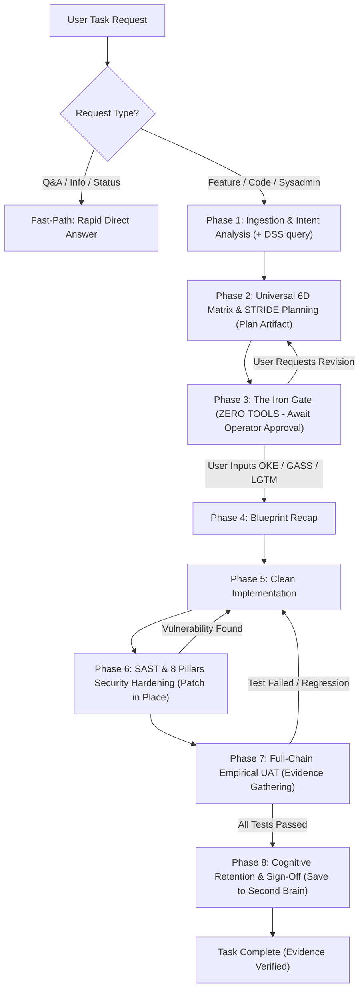

<p align="center">
  
</p>

# 🛡️ FRIDAY-PROTOCOL v2.0

> **F**ramework for **R**igorous, **I**ntelligent, **D**eliberate, and **A**utonomous **Y**ields  
> *The Spec-Driven, DevSecOps-First, and BSSN-Aligned Governance Protocol for Autonomous AI Agents.*

[](https://www.npmjs.com/package/friday-protocol)
[](https://www.npmjs.com/package/friday-protocol)
[](LICENSE)
[]()
[]()

---

## ⚡ What is FRIDAY-PROTOCOL v2.0?

Most AI coding agents suffer from three fatal flaws:
1. **Eager Execution Bias:** The AI begins generating code immediately before you review the architecture or consider security threats.
2. **Ping-Pong QA & Tunnel Vision:** Fixing one UI bug silently breaks downstream PDF generation, state persistence, or worker queues.
3. **Broken Access Control & Security Negligence:** The AI hides buttons via client-side CSS (`display: none` / `v-if`) while leaving backend endpoints and WebSocket channels completely unguarded.

**FRIDAY-PROTOCOL v2.0 transforms your AI into an elite, security-conscious Staff Engineer** by integrating:
- **NIST SP 800-160/154 Adversarial Thinking** & **STRIDE Threat Modeling**.
- **8 Pillars of Secure Backend Engineering (BSSN-Aligned)**.
- **UU No. 27/2022 Pelindungan Data Pribadi (UU PDP)** compliance with AES-256-CBC and Blind Indexing.
- **Turnkey DevSecOps Pipeline Recipes** (GitLab CI, GitHub Actions, Pre-Commit, OWASP ZAP DAST).

---

## 🏛️ The 5 Iron Laws

1. **Law of Deliberation:** The AI is strictly FORBIDDEN from touching code until the Operator explicitly approves the Implementation Plan.
2. **Law of Universal 6D Lifecycle Matrix & STRIDE:** Every feature must map its journey across 6 dimensions (*Source $\rightarrow$ Runtime State $\rightarrow$ Persistence $\rightarrow$ Downstream Consumers $\rightarrow$ Security & STRIDE $\rightarrow$ Failure Modes*).
3. **Law of Security-First (Early Gate):** SAST (8 Pillars BSSN + UU PDP) and Multi-Role checks must pass **BEFORE** functional UAT to eliminate regression loops.
4. **Law of Empirical Proof:** The AI may never declare a task "complete" without hard, objective proof (exit code 0, HTTP 200 OK, test coverage $\ge 80\%$, terminal logs).
5. **Law of Cognitive Closed-Loop (Optional):** Integrates with external Knowledge Graphs (e.g. MemoriaGraph) to query past decisions before planning and retain learned heuristics after deployment.

---

## 🔒 4-Layer Anti-Bypass Guard (Always-Proceed Proof)

Even when `--dangerously-skip-permissions`, YOLO mode, or `Always Proceed` is active:
- **Zero-Tool Turn Termination:** Once the plan is drafted, the agent executes **zero tools**, forcing the autonomous loop to halt and yielding control back to the human operator.
- **Semantic Approval Token:** Code editing tools are programmatically locked until the operator explicitly inputs a manual token: `['LGTM', 'CONFIRMED', 'EXECUTE', 'GO', 'OKE', 'GASS']`.
- **Anti-Synthetic Approval:** Automated system tokens like `'Proceed'` or `'Approve'` from stop-hook loops are strictly ignored.

---

## 🚀 Quick Start (Zero-Install CLI)

### 1. Activate AI Agent Governance
Run directly via `npx` (no pre-cloning required):

```bash
npx friday-protocol
```

Flags for automated / CI setup:
```bash
# Universal global setup for Antigravity, Claude, and Cursor
npx friday-protocol -y

# Specific agent environment & workspace scope
npx friday-protocol --env antigravity --scope workspace -y
```

### 2. Deploy Turnkey DevSecOps CI/CD Recipes
You can scaffold production-grade DevSecOps pipelines into any existing project repository with one command:

```bash
# Deploy GitLab CI DevSecOps Pipeline (.gitlab-ci.yml)
npx friday-protocol --recipe gitlab-ci

# Deploy GitHub Actions DevSecOps Workflow (.github/workflows/devsecops.yml)
npx friday-protocol --recipe github-actions

# Deploy Git Pre-Commit Security Hooks (.pre-commit-config.yaml with Gitleaks)
npx friday-protocol --recipe pre-commit

# Deploy OWASP ZAP Baseline DAST Runner scripts (scripts/run-zap-baseline.ps1 & .sh)
npx friday-protocol --recipe dast

# Deploy everything at once
npx friday-protocol --recipe all
```

---

## 🔄 The 8-Phase DevSecOps Pipeline



---

## 🛡️ The 8 Pillars of Secure Backend Engineering (BSSN-Aligned)

All code modified under FRIDAY-PROTOCOL must satisfy the 8 security pillars in [sast-checklist.md](skills/friday-protocol/references/sast-checklist.md):

1. **Authentication & Session Governance:** Short TTL JWT access tokens (5–15 min), refresh tokens stored in `HttpOnly, Secure` cookies, explicit revocation list.
2. **SQL & Command Injection Prevention:** Mandatory parameter binding, ORM hygiene, zero concatenation in query builders.
3. **Mass Assignment Prevention:** Granular single-responsibility endpoints, explicit `$fillable` or DTO schemas, strict privilege guarding.
4. **Multi-Layer File Upload Defense:** MIME + extension whitelist, magic bytes inspection, cryptographically secure random UUID file naming, private cloud storage with temporary signed URLs.
5. **Non-Repudiation & Audit Trail:** Structured append-only audit trail logging (Actor, Action, Resource, Server UTC Timestamp, IP, User Agent, State Delta).
6. **UU PDP Compliance & Privacy Data Handling:** Strong encryption at rest (**AES-256-CBC** + unique IV + MAC) for all PII; **Blind Indexing (`*_hash`)** for high-speed queries without plaintext leakage; UI/API data masking.
7. **DoS & Resource Exhaustion Defense:** Route-level throttling middleware (e.g. 5 req/min), invisible anti-bot honeypot form fields, worker queue offloading.
8. **Elevation of Privilege & BFLA/BOLA:** Server-side Gate and Policy checking; strict tenant scoping (`WHERE id = :id AND user_id = :currentUser`); isolated WebSocket rooms (`io.to('admin')`).

---

## 📂 Repository Layout

```text
friday-protocol/
├── README.md                                  # Comprehensive Guide & Documentation
├── LICENSE                                    # MIT License
├── package.json                               # npm package manifest (v2.0.0)
├── bin/
│   └── cli.js                                 # Interactive CLI with recipe deployment
├── core/
│   └── rules/
│       ├── GEMINI.md                          # Governance rule template for Gemini / Antigravity
│       ├── CLAUDE.md                          # Governance rule template for Claude Code
│       ├── .cursorrules                       # Governance rule template for Cursor / Windsurf
│       └── AGENTS.md                          # Standard rule for Multi-Agent swarms
├── skills/
│   └── friday-protocol/
│       ├── SKILL.md                           # Comprehensive SOP & 8-Phase Runbook
│       └── references/
│           ├── 6d-matrix.md                   # 6D Lifecycle Matrix & STRIDE Threat Modeling
│           ├── sast-checklist.md              # 8 Pillars of Secure Backend & UU PDP Checklist
│           └── devsecops-pipeline.md          # Architecture & Tooling Guide (Trivy, Gitleaks, ZAP)
├── recipes/                                   # TURNKEY DEVSECOPS RECIPES
│   ├── ci/
│   │   ├── gitlab-ci-devsecops.yml            # GitLab CI pipeline configuration
│   │   └── github-actions-devsecops.yml       # GitHub Actions workflow
│   ├── pre-commit/
│   │   └── .pre-commit-config.yaml            # Pre-commit configuration for local Gitleaks
│   ├── dast/
│   │   ├── run-zap-baseline.sh                # OWASP ZAP Baseline Runner (Linux/macOS)
│   │   └── run-zap-baseline.ps1               # OWASP ZAP Baseline Runner (Windows)
│   └── docker/
│       └── compose-security-lab.yml           # Vulnerability testing lab (DVWA, SonarQube)
└── templates/
    ├── plan-template.md                       # Implementation Plan template with STRIDE table
    ├── uat-checklist.md                       # Empirical UAT verification sheet
    └── rfc-template.md                        # ITIL & BSSN Request For Change (RFC) template
```

---

## 📄 License

MIT License. Designed by Bos Maskii (Lucky Hermawan) & F.R.I.D.A.Y.
