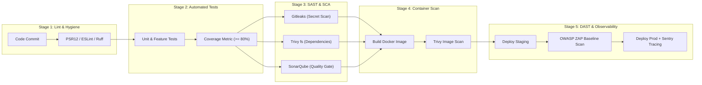

# 🚀 DevSecOps Pipeline & Tooling Reference Guide

> **Standard:** FRIDAY-PROTOCOL v2.0.0  
> **Mandate:** Standard operating procedure for automated security verification across the software development lifecycle (SDLC).  
> **Toolchain:** Linter, Unit Coverage, Gitleaks, Trivy (SCA & Container), SonarQube/SonarCloud, OWASP ZAP (DAST), and Sentry.

---

## 🏗️ DevSecOps Pipeline Architecture



---

## 🛠️ The Core DevSecOps Toolchain

### 1. Secret Detection (Gitleaks)
- **Purpose:** Scans the codebase, commit history, and diffs for exposed API keys, private tokens, passwords, and cloud credentials before they reach the remote repository.
- **Local / Docker Command:**
  ```bash
  docker run --rm -v "$(pwd):/repo" zricethezav/gitleaks:latest detect --source /repo --verbose
  ```
- **Pipeline Gate:** Any unsuppressed secret detection causes the pipeline to exit immediately with Code 1 (FAIL).

### 2. Software Composition Analysis (Trivy fs)
- **Purpose:** Analyzes project lockfiles (`composer.lock`, `package-lock.json`, `requirements.txt`, `go.sum`) against the global CVE vulnerability database.
- **Local / Docker Command:**
  ```bash
  docker run --rm -v "$(pwd):/app" aquasec/trivy:latest fs --severity HIGH,CRITICAL /app
  ```
- **Mitigation:** Update or replace vulnerable third-party libraries before merging.

### 3. Container Image Scanning (Trivy image)
- **Purpose:** Scans application base images and container packages (OS libraries like OpenSSL, libc) for known vulnerabilities before pushing to production registries.
- **Local / Docker Command:**
  ```bash
  docker run --rm -v /var/run/docker.sock:/var/run/docker.sock aquasec/trivy:latest image --severity HIGH,CRITICAL <image-name>:latest
  ```

### 4. Static Code Quality & Security (SonarQube / SonarCloud)
- **Purpose:** Identifies security hotspots, code smells, duplicate blocks, and tracks unit test coverage against organization Quality Gates.
- **Runner Execution:**
  ```bash
  docker run --rm -v "$(pwd):/usr/src" \
    -e SONAR_HOST_URL="https://sonarcloud.io" \
    -e SONAR_SCANNER_OPTS="-Dsonar.organization=<org> -Dsonar.projectKey=<project>" \
    -e SONAR_TOKEN="<token>" \
    sonarsource/sonar-scanner-cli
  ```

### 5. Dynamic Application Security Testing (OWASP ZAP)
- **Purpose:** Tests the running web application externally from an attacker's perspective without needing source code access (DAST).
- **Baseline Scan Command:**
  ```bash
  docker run --rm -v "$(pwd):/zap/wrk" zaproxy/zap-stable \
    zap-baseline.py -t http://host.docker.internal:8000 -r zap-report.html
  ```

### 6. Production Observability & Error Tracking (Sentry)
- **Purpose:** Real-time capture of unhandled exceptions, performance bottlenecks, and stack traces in production environments.
- **Security Rule:** Mask all authorization headers, cookies, passwords, and PII from outgoing Sentry breadcrumbs and exception contexts.

---

## ⚡ Local Pre-Commit Integration

To prevent accidental secret leaks and unformatted code from entering git:
1. Install pre-commit tool: `pip install pre-commit` (or `npm install --save-dev pre-commit`).
2. Copy the recipe: `.pre-commit-config.yaml` to project root.
3. Activate the hook:
   ```bash
   pre-commit install
   ```
Now, every `git commit` automatically runs Gitleaks and hygiene linters locally before recording changes!
